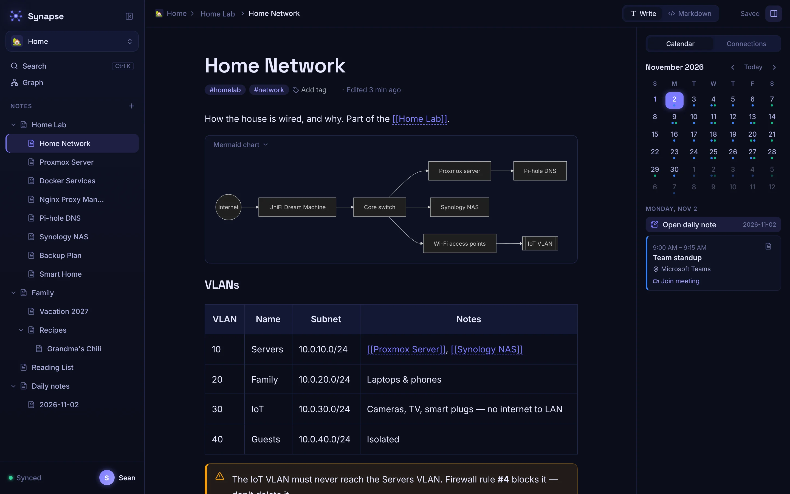
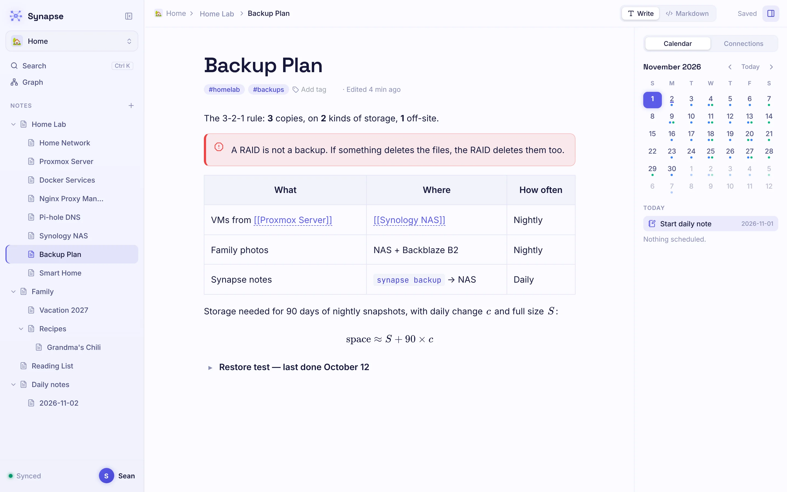
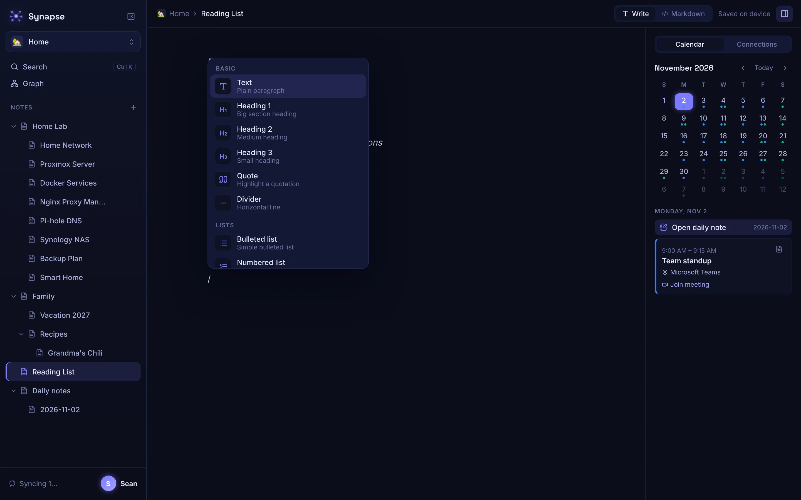
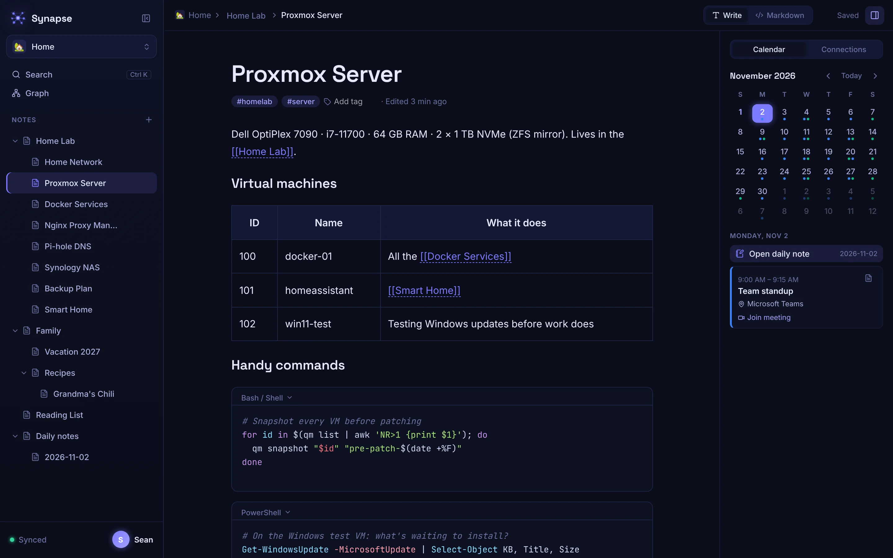
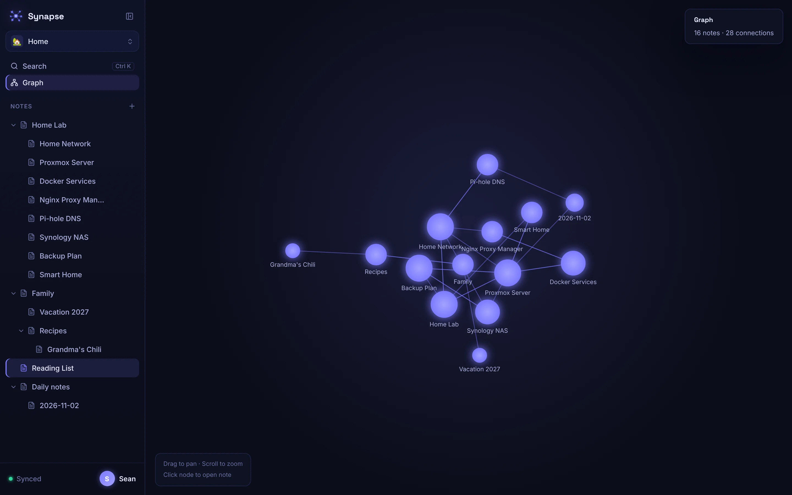
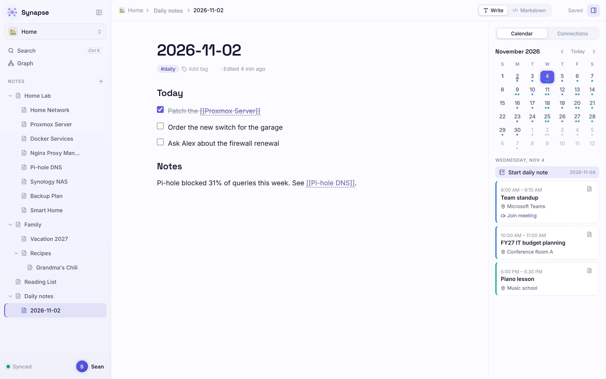
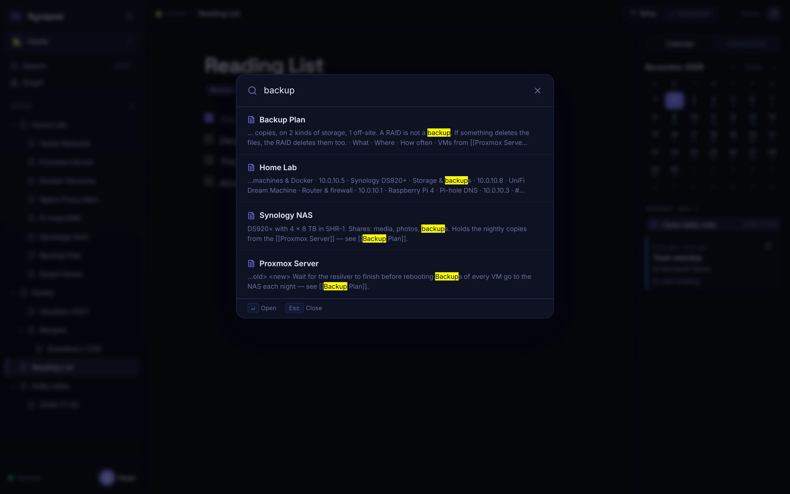
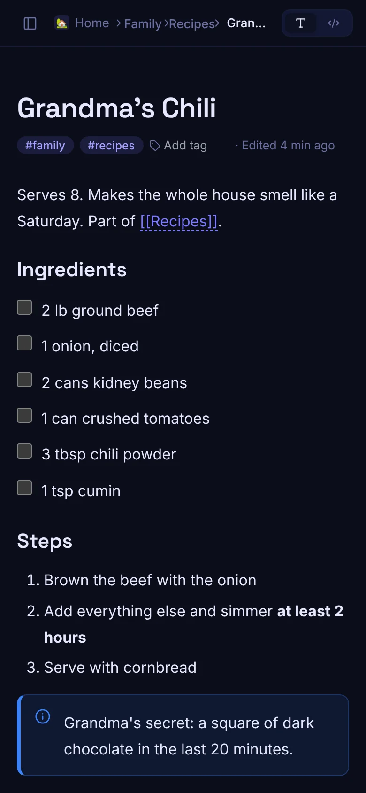

<div align="center">


# Synapse

**Your connected knowledge base — self-hosted, offline-first, and yours.**

Write notes that look finished as you type, link them together, see your meetings next to them,
and keep everything on your own server.

[Install](#install) · [Screenshots](#a-quick-tour) · [Features](#features) · [The `synapse` command](#the-synapse-command)

<br/>



</div>

---

## Why Synapse?

- **Yours.** One Docker container on your own server. Your notes live in one data folder (a SQLite database plus uploads) that `synapse backup` saves in one step.
- **Fast to write in.** What you see is the finished note, but it understands Markdown as you type. Press `/` for anything else.
- **Connected.** Type `[[` to link notes; the graph shows how everything fits together.
- **Works offline.** Every device keeps its own copy. Keep writing on a plane; it syncs when you're back.
- **Easy to run.** A one-line installer that asks plain questions — no YAML required.

---

## A quick tour

### Notes that look finished while you write

Headings, checklists, tables, callouts, toggles, code with syntax colors, math and diagrams — all from the keyboard.
Everything is still stored as Markdown, and any note can be switched to raw Markdown with a live preview.



### Type `/` for anything

The menu is grouped — Basic, Lists, Callouts, Media, Math, Diagrams, Notes & links, Date & time — and you can search it (`/video`, `/inline math`, `/toc`…).



### Code that reads like code

~95 languages with syntax colors that follow your theme: PowerShell, Bash, Batch, Python, SQL, YAML, Dockerfile, Nginx and more. Pick the language from a searchable list or let it auto-detect; one click copies the code.



### See how your notes connect

Every `[[link]]` becomes a line in the graph. Click a dot to open that note.



### Your calendar, next to your notes

Connect Outlook, Google, iCloud or any calendar by its link. See the week's meetings beside your notes, open a daily note for any day,
and turn a meeting into a meeting note with the time, place, join link and attendees filled in.



### Find anything

<kbd>Ctrl</kbd> + <kbd>K</kbd> searches every note, even with no connection.



### On your phone, too

Install it to your home screen and it works like an app — online or off.

<p align="center"></p>

---

## Features

**Writing**
- **Write as you read**: the editor shows finished formatting and understands Markdown as you type (`# `, `**bold**`, `- `, `[] `, `> `, ```` ``` ````). Select text for a formatting toolbar with any text or highlight color (hex codes and a full color picker)
- **"/" menu**: headings, lists, checklists, **toggle sections**, **callouts** (Note / Tip / Warning / Danger), tables, **image upload**, **video** (YouTube, Vimeo, Loom, video files), **math** (LaTeX), **Mermaid charts**, **draw.io** and **Excalidraw** diagrams, a live **table of contents**, new sub-notes, and today's date or time
- **Code blocks**: ~95 languages with theme-aware colors, a searchable language picker, auto-detect and a Copy button. Shortcut: ```` ```ps1 ```` + space
- **Markdown view**: switch any note to raw Markdown, with split view and preview. Everything above round-trips: callouts as `> [!NOTE]`, math as `$…$`, Mermaid as ```` ```mermaid ````
- **Other note types**: a simple flowchart editor and a freehand whiteboard with sticky notes

**Organizing**
- **Workspaces**: keep Home, Work and so on apart, each with its own icon, color and settings
- **Nested notes** with drag and drop
- **Wiki links**: type `[[` to link a note (or create it); backlinks show in the side panel
- **Graph view** of every connection
- **Tags** and **full-text search** (<kbd>Ctrl</kbd> + <kbd>K</kbd>)
- **Calendar & daily notes**: meetings from any ICS calendar link, daily notes, and a menu on each meeting to make a meeting note, a to-do or a daily-note entry
- **Tasks**: to-dos from meetings and daily notes, plus any checklist item with a due date, in one view (Overdue / Today / Next 7 days / Later / No date). Tick them off or set due dates there; the note is updated. Tag a note `#no-tasks` to keep it out

**Running it**
- **Offline-first**: every device keeps a copy; changes sync when you're back online, and conflicts never lose work
- **Installable** on phones and computers as an app
- **Themes**: Neural (default) and Neural Light, following your device's light/dark setting, plus Dark, Light, Dracula, Nord, Solarized and Tokyo Night
- **Multi-user**: the first account is the admin, who adds everyone else
- **Two-step verification**: authenticator apps (works with Bitwarden, 1Password…), passkeys (Face ID, Touch ID, Windows Hello, security keys) and recovery codes
- **Easy install & maintenance**: one-line installer, HTTPS with or without a domain, notes on a local disk, Docker volume or network share, and a `synapse` command for updates, backups and fixes
- **Proxy-ready**: works behind Nginx Proxy Manager, Cloudflare Tunnel and others

---

## Install

On a Linux server (64-bit PC / VM), run:

```bash
curl -fsSL https://raw.githubusercontent.com/Stevy2191/synapse/main/install.sh | sudo bash
```

The installer:

- checks your system and offers to install Docker if it's missing
- installs into the folder you run it from (e.g. `cd /srv/docker/synapse` first), or suggests `/opt/synapse`. If Synapse is already set up there, by the installer or by hand, it offers to update it and adds the `synapse` command
- asks how you'll open Synapse:
  1. **On your home network**: `http://192.168.x.x:3001`
  2. **Through your reverse proxy** (Nginx Proxy Manager, Cloudflare Tunnel…), printing the settings to enter
  3. **At your own web address with HTTPS**: sets up [Caddy](https://caddyserver.com), which gets a free Let's Encrypt certificate automatically
  4. **HTTPS without a domain**: `https://192.168.x.x:8443`. Caddy creates this server's own certificate, and a small **trust page** (with a QR code) walks each phone or computer through trusting it once. After that there are no warnings, and offline mode works
- checks which ports are free, tells you what's using a busy one, and suggests a free one
- offers to run **your own draw.io** for diagrams (optional: by default diagrams use the free diagrams.net editor, which needs internet). It's set up to match how you open Synapse, including HTTPS with the same certificate. Changed your mind later? Run `synapse drawio on` (or `off`), or re-run the installer and pick it from the menu
- asks where to keep your notes:
  1. **A folder on this server**: `./data` by default, or any path, such as a second drive or USB disk (it lists mounted drives with their free space). If the folder already holds Synapse notes, they're used
  2. **A Docker volume**: Docker manages the storage
  3. **A network share (SMB)**: a NAS or a Windows shared folder (`\\nas\notes`, `//nas/notes` or `smb://nas/notes`). The installer tests the share before using it, and explains wrong passwords, missing folders or unreachable servers plainly. The database runs in a mode that's safe on network storage
- opens the port in your firewall (ufw / firewalld) if one is active
- prints the address and a **setup code** for creating the admin account

Prefer no questions? Pass the answers: `… | sudo bash -s -- --yes --mode home --port 3001 --storage folder` (see `install.sh --help`).

Installing by hand with Docker Compose instead? Download [`docker-compose.yml`](docker-compose.yml), then `docker compose up -d`; the setup code is printed in `docker compose logs`.

---

## First Run

1. Open the address the installer printed
2. Enter the **setup code** and create your account. The first account is the **admin**.
   (Lost the code? Run `synapse setup-code`.)
3. Add family members or teammates from **Settings → Admin**
4. Start writing

The setup code stops a stranger from claiming the admin account before you do. It's deleted once the admin exists.

---

## The `synapse` command

| Command | What it does |
|---|---|
| `synapse status` | Is it running, and at what address? |
| `synapse update` | Download and start the latest version |
| `synapse backup [folder]` | Save notes, uploads and settings to a `.tar.gz` |
| `synapse restore <file>` | Restore a backup (the current data is kept aside) |
| `synapse logs [-f]` | Recent logs (`synapse logs caddy` for HTTPS) |
| `synapse setup-code` | Show the admin setup code |
| `synapse users` | List accounts |
| `synapse reset-password <user>` | New temporary password (works for the admin too) |
| `synapse reset-mfa <user>` | Turn off someone's two-step verification (lost phone) |
| `synapse make-admin <user>` | Make someone an admin |
| `synapse port <number>` | Move to another port (checks it's free) |
| `synapse trust` | HTTPS without a domain: show the trust page address and QR code |
| `synapse set-ip [address]` | HTTPS without a domain: update after the server's IP changes (devices stay trusted) |
| `synapse drawio on [port]` / `off` | Run your own draw.io for diagrams (works offline), or go back to diagrams.net |
| `synapse restart` / `stop` / `start` | |
| `synapse uninstall` | Remove Synapse (asks before deleting notes) |

---

## Calendar & Daily Notes

The panel on the right (button at the top right) has a **Calendar** tab:

- **Days with meetings** have coloured dots; days with a daily note are underlined.
- **Click a day** to see its meetings; **double-click** it (or use *Open daily note*) to open that day's note, titled like `2026-11-01`, kept in a **Daily notes** folder.
- **The + menu on a meeting** offers:
  - **Meeting note**: "Team standup · Nov 4, 2026", kept in **Meetings › November 2026**, with the time, place, join link and attendees filled in, plus Agenda, Notes and Action items. The day's daily note links to it.
  - **Add a to-do…**: type the task and pick a due date (the meeting's day by default). It goes into the meeting note's *Action items* and shows up in **Tasks**.
  - **Add to daily note**: lists the meeting in that day's note.
  - **Copy join link** for online meetings.

**Tasks** (in the sidebar) gathers to-dos, grouped by when they're due, with a badge for anything due today or overdue. It shows everything from meeting and daily notes, plus checklist items anywhere that have a due date; switch to **All checklists** to see the rest too. Tag a note `#no-tasks` (a recipe, a packing list) to keep it out of Tasks entirely. A due date is part of the task's text — `📅 2026-11-20` — so it works in Write and Markdown and survives export. Ticking a box or changing a date in Tasks changes the note itself; *Add a task* puts it in today's daily note.

**Connect calendars** in **Settings → Calendars** by pasting a calendar's ICS link (steps for Outlook, Google, iCloud and others are shown there). Synapse reads them every 15 minutes, never changes them, and keeps the events on your device so the calendar works offline.

> Outlook work accounts: your organisation may block "Publish a calendar". If so, ask IT or use a personal calendar.

---

## Two-Step Verification

Each person turns it on in **Settings → Security**:

- **Authenticator app**: scan a QR code with Google Authenticator, Microsoft Authenticator, 1Password, Authy… Signing in then asks for the 6-digit code after the password.
- **Passkeys**: Face ID, Touch ID, Windows Hello, an Android phone or a security key. Use one as the second step, or tap **Sign in with a passkey** to skip the password entirely.
- **Recovery codes**: 10 one-time codes, shown when two-step verification is first turned on. Each works once if the phone is lost.

Lost phone *and* recovery codes? An admin can turn it off in **Settings → Admin → Reset 2-step**, or on the server: `synapse reset-mfa <username>`.

> Passkeys need Synapse on **HTTPS with a domain name** (install options 2 or 3). Browsers don't allow them on an IP address. Authenticator-app codes work everywhere.

---

## Offline Mode

Synapse keeps a copy of your notes on each device, so you can open, search, write and organise notes without a connection.

- **While offline**, the badge in the top bar shows **Offline · N waiting**. Everything you do is saved on the device right away.
- **When you reconnect**, waiting changes upload automatically (or click the badge to sync now), and changes made on your other devices download.
- **Conflicts never lose work.** If a note was edited on another device while you were offline, the other device's version stays, and yours is saved next to it as **"Title (conflict copy)"**. Merge them by hand and delete the copy.
- **Install it:** in Chrome or Edge use *Install app* in the address bar; on iPhone use *Share → Add to Home Screen*.

Notes:
- Your first sign-in on a device needs a connection.
- Offline mode needs **HTTPS** (or `localhost`) for the app to open with no connection. No domain? Install option 4 gives HTTPS on the server's IP address. Your notes are still stored locally over plain HTTP, but the page itself won't load offline.
- Creating workspaces and uploading attachments still need a connection.
- Signing out removes the device's copy of your notes (you'll be warned if anything hasn't uploaded yet).

---

## Nginx Proxy Manager

| Setting | Value |
|---------|-------|
| Scheme | http |
| Forward Hostname | synapse |
| Forward Port | 3001 |
| Websockets | Enabled |
| SSL | Let's Encrypt |

---

## Environment Variables

| Variable | Default | Description |
|----------|---------|-------------|
| `JWT_SECRET` | auto-generated | Signs login tokens. If unset, a random one is created and saved to `data/.jwt_secret` |
| `DRAWIO_URL` | `https://embed.diagrams.net` | Where the draw.io editor loads from. Run your own (`docker run -p 8080:8080 jgraph/drawio`) and set this to keep diagrams fully self-hosted and usable offline |
| `SETUP_CODE` | random | Code needed to create the admin account. `off` to skip it (trusted networks only) |
| `ALLOW_REGISTRATION` | `false` | `true` lets anyone create an account. Otherwise only the first user (admin) can register |
| `CORS_ORIGIN` | unset | Only needed if a different site calls the API from a browser (comma-separated list) |
| `PORT` | `3001` | Internal port |
| `DATA_DIR` | `/data` | Database and uploads location |

---

## Local Development

```bash
cd backend && npm install && npm run dev      # API on :3001 (data in ./data)
cd frontend && npm install && npm run dev     # UI on :5173, proxies /api to :3001
```

---

## Architecture

- **Backend:** Node.js + Express + better-sqlite3 (WAL mode)
- **Frontend:** React 18 + Vite + TipTap + CodeMirror + D3.js, with highlight.js (code), KaTeX (math) and Mermaid (charts, loaded only when used); themes are CSS variables in `frontend/src/themes/`
- **Auth:** JWT (7-day expiry)
- **Search:** SQLite FTS5 with porter stemmer on the server; in-browser search of the local copy in the app
- **Offline:** Service worker (vite-plugin-pwa) caches the app; IndexedDB holds notes plus an outbox of pending changes (`frontend/src/offline/`). Notes carry a version number so the server can detect conflicting edits
- **Graph:** D3 force simulation
- **Image:** Alpine Linux, hosted on GHCR
